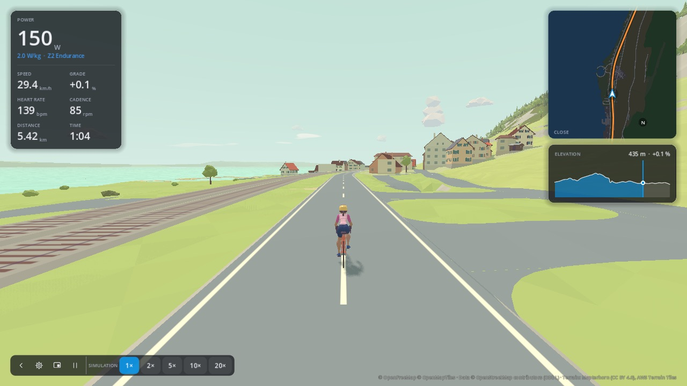
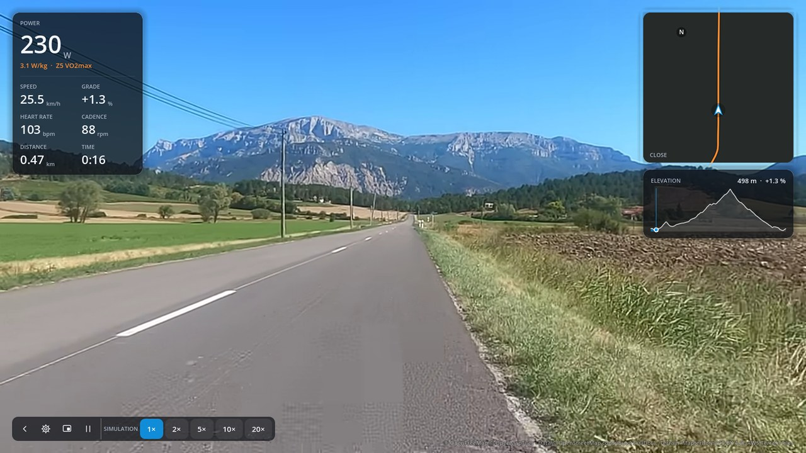
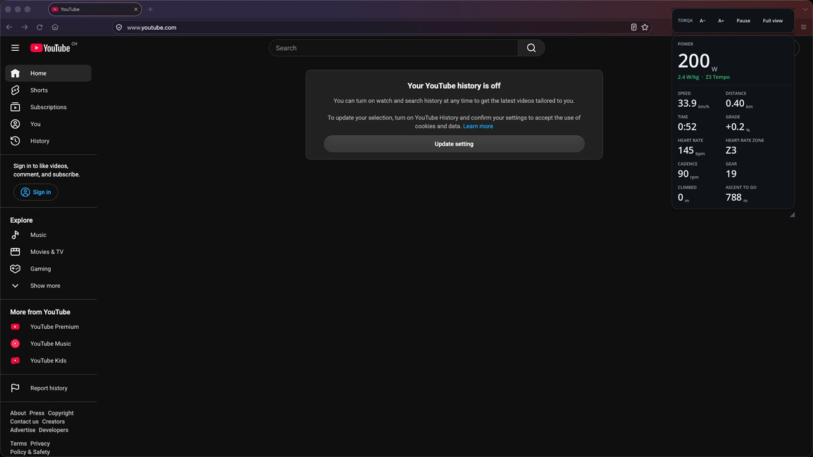

  <picture>
    <source media="(prefers-color-scheme: dark)" srcset="docs/brand/torqa-lockup-dark.svg">
    
  </picture>

<em>Killer watts. No cloud.</em>

  
  
  
  
  

# Torqa

A modern, offline-first, open-source indoor cycling app. Import a GPX route or a ride video and
ride it on your smart trainer, through a generated 3D world or along the video.

<table>
  <tr>
    <td colspan="2" align="center">
       
      Any GPX route as a 3D world, here along the Bielersee
    </td>
  </tr>
  <tr>
    <td width="50%" align="center">
       
      Along a real video, played at your speed
    </td>
    <td width="50%" align="center">
       
      Just your HUD, on top of any window
    </td>
  </tr>
</table>

Video: <a href="https://cycling.vangestel.online">“Le petit Menglonnais”</a> by Fred Van
Gestel, <a href="https://creativecommons.org/licenses/by-nc-sa/4.0/">CC BY-NC-SA 4.0</a>.

> [!WARNING]
> **Written by AI, ridden at your own risk.** Every line of Torqa is written by AI. It comes
> with no warranty of any kind, and we accept no liability for injury to you or for damage to
> your trainer, bike or any other gear (sections 15 and 16 of the [GPL-3.0](LICENSE)).

> [!NOTE]
> Torqa is in early development: [docs/PLAN.md](docs/PLAN.md) shows what is done and what
> comes next.

## Features

<table>
  <tr>
    <td width="50%">🚴 <b><a href="docs/riding.md#devices">Smart trainers</a></b> 
      Bluetooth FTMS (SIM, ERG, resistance) and heart-rate straps; your devices reconnect at start</td>
    <td width="50%">🗺️ <b><a href="docs/riding.md#the-3d-world">Any GPX in 3D</a></b> 
      A stylized world from real terrain and OpenStreetMap, with weather and time of day</td>
  </tr>
  <tr>
    <td>🎬 <b><a href="docs/video.md">Video courses</a></b> 
      GoPro, Incyclist, Tacx RLV or any video matched to a GPX; it plays at your speed</td>
    <td>💪 <b><a href="docs/workouts.md">Workouts</a></b> 
      Hold a power or a heart rate, ZWO / ERG / MRC / FIT with an editor, three FTP tests</td>
  </tr>
  <tr>
    <td>⚙️ <b><a href="docs/riding.md#virtual-gears">Virtual gears</a></b> 
      24 gears on a single cog, shifted from the keyboard or Shimano Di2 hood buttons</td>
    <td>🪟 <b><a href="docs/overlay.md">Overlay</a></b> 
      Just your HUD, on top of a video or any other window</td>
  </tr>
  <tr>
    <td>👻 <b><a href="docs/ghosts.md">Ghosts &amp; pacers</a></b> 
      Race your best ride, a friend's activity or a pacer at your FTP</td>
    <td>📈 <b><a href="docs/history.md">History &amp; records</a></b> 
      Ride analysis, personal records per course and climb, FIT export and
      <a href="docs/uploads.md">upload to intervals.icu</a></td>
  </tr>
</table>

📴 Courses ride offline on any computer · ⚖️ realistic physics, adjustable difficulty ·
🎛️ a HUD your way · 🌍 English and German · 🖥️ macOS, Windows and Linux

**Planned:** Street View / Mapillary rides, uploads to Strava, ANT+ FE-C, hardware video
decoding — see [docs/REQUIREMENTS.md](docs/REQUIREMENTS.md).

## Using Torqa

| Topic | Doc |
|---|---|
| Start page, course gallery and course pages | [docs/start.md](docs/start.md) |
| Courses: offline riding and sharing | [docs/courses.md](docs/courses.md) |
| Video courses | [docs/video.md](docs/video.md) |
| Devices, riding and in-ride settings | [docs/riding.md](docs/riding.md) |
| Riders, zones | [docs/riders.md](docs/riders.md) |
| Ride HUD | [docs/hud.md](docs/hud.md) |
| Workouts and FTP tests | [docs/workouts.md](docs/workouts.md) |
| Overlay over other apps | [docs/overlay.md](docs/overlay.md) |
| Uploading rides to intervals.icu | [docs/uploads.md](docs/uploads.md) |
| Ghosts and pacers | [docs/ghosts.md](docs/ghosts.md) |
| Ride history, climbs and records | [docs/history.md](docs/history.md) |
| Music control | [docs/audio.md](docs/audio.md) |
| Translations | [docs/translating.md](docs/translating.md) |
| Command-line tool for testing trainers | [docs/cli.md](docs/cli.md) |

## Download

There are no releases yet. The builds for macOS (Apple silicon), Windows and Linux are
artifacts of the [CI runs on `main`](https://github.com/bossm8/Torqa/actions/workflows/ci.yml?query=branch%3Amain)
(download them while signed in to GitHub); [docs/development.md](docs/development.md#builds)
says which file is which.

## Contributing

Everything runs in a dev container: setup, checks and builds are in
[docs/development.md](docs/development.md). Conventions: [CLAUDE.md](CLAUDE.md); architecture
decisions: [docs/adr/](docs/adr/); third-party assets: [docs/CREDITS.md](docs/CREDITS.md).

## License

[GPL-3.0](LICENSE). The video-course screenshot shows a frame of a CC BY-NC-SA 4.0 video and is
under that licence (see [docs/CREDITS.md](docs/CREDITS.md)).
