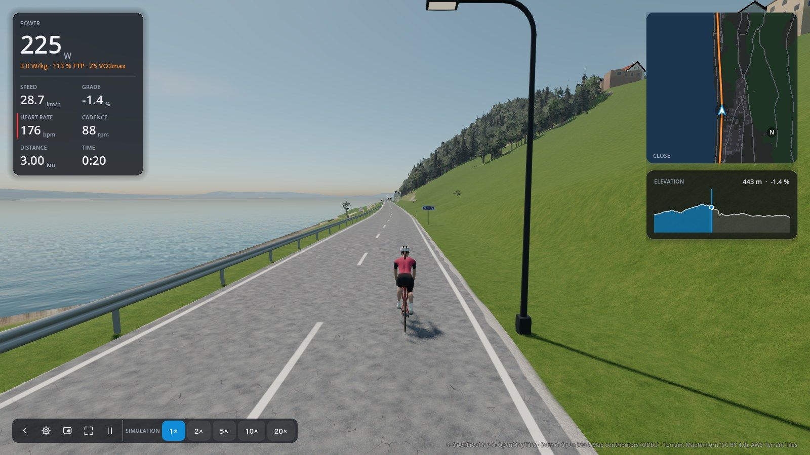
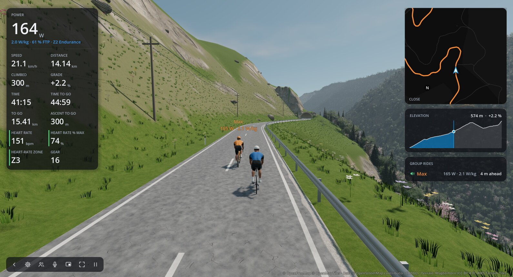
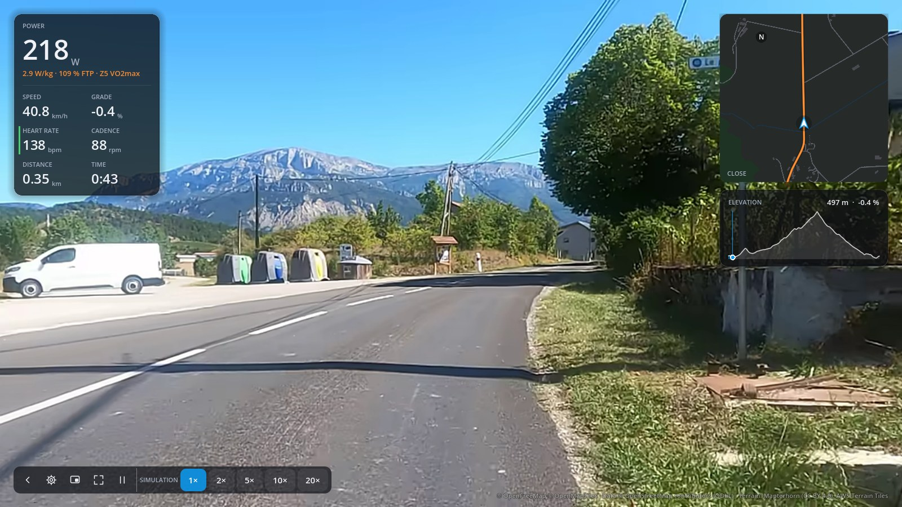
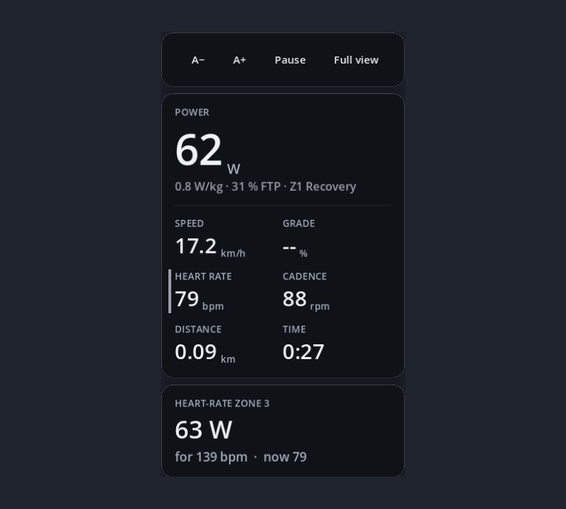

  <picture>
    <source media="(prefers-color-scheme: dark)" srcset="docs/brand/orqwa-lockup-dark.svg">
    
  </picture>

<strong>Make waves with watts, not payments</strong>

Open-source · Free · Local-first · Indoor cycling

  
  
  
  
  

ORQWA is a free, open-source indoor cycling app. Import a GPX route or a ride video and ride it
on your smart trainer, through a 3D world or along the video, alone or with friends.

<table align="center">
  <tr>
    <td width="50%" align="center">
       
      A GPX route along the Bielersee in 3D
    </td>
    <td width="50%" align="center">
       
      A group ride with a friend
    </td>
  </tr>
  <tr>
    <td width="50%" align="center">
       
      A ride video, played at your speed
    </td>
    <td width="50%" align="center">
       
      Your ride figures over another window
    </td>
  </tr>
</table>

Video: <a href="https://cycling.vangestel.online">“Le petit Menglonnais”</a> by Fred Van
Gestel, <a href="https://creativecommons.org/licenses/by-nc-sa/4.0/">CC BY-NC-SA 4.0</a>.

[More screenshots](docs/screenshots.md).

> [!WARNING]
> **Written by AI, ridden at your own risk.** Every line of ORQWA is written by AI. It comes
> with no warranty of any kind, and we accept no liability for injury to you or for damage to
> your trainer, bike or any other gear (sections 15 and 16 of the [GPL-3.0](LICENSE)).

## Features

- **[3D routes](https://github.com/ORQWA/ORQWA/wiki/Courses#import-a-course):** Import a GPX route
  and ride through scenery based on real terrain and OpenStreetMap.
- **[Video rides](https://github.com/ORQWA/ORQWA/wiki/Video-courses):** Ride along with a video
  that plays at your speed.
- **[Continue another day](https://github.com/ORQWA/ORQWA/wiki/Courses#continue-another-day):**
  Save your place in a solo 3D or video course and continue with a fresh activity next time.
- **[Group rides](https://github.com/ORQWA/ORQWA/wiki/Group-rides):** Ride in a group of up to
  eight people, with voice chat, and choose the next ride together in the same lobby.
- **[Workouts](https://github.com/ORQWA/ORQWA/wiki/Workouts):** Import or create workouts,
  train to power or heart-rate targets, and take FTP tests.
- **[Trainers and sensors](https://github.com/ORQWA/ORQWA/wiki/Devices-and-riding#devices):**
  Connect supported Bluetooth trainers, power meters, cadence sensors and heart-rate straps.
- **[Virtual gears](https://github.com/ORQWA/ORQWA/wiki/Devices-and-riding#virtual-gears):**
  Shift with a keyboard, compatible shifter or your phone.
- **[Ghosts and pacers](https://github.com/ORQWA/ORQWA/wiki/Ghosts-and-pacers):** Ride against
  a previous activity or follow a pacer.
- **[Ride history](https://github.com/ORQWA/ORQWA/wiki/Ride-history):** Review your rides and
  records, and [upload activities to Strava or intervals.icu](https://github.com/ORQWA/ORQWA/wiki/Uploading-rides).
- **[Overlay](https://github.com/ORQWA/ORQWA/wiki/Overlay):** See your ride figures over
  other windows on macOS, Windows and Linux (X11), or in picture-in-picture on Android.
- **[Offline riding](https://github.com/ORQWA/ORQWA/wiki/Getting-started#when-orqwa-needs-the-internet):**
  Ride prepared courses without an internet connection.

## Download

Download ORQWA from the [Releases page](https://github.com/ORQWA/ORQWA/releases) for
macOS (Apple silicon), Windows, Linux or Android tablets.

For the latest development build, download an artifact from the
[CI runs on `main`](https://github.com/ORQWA/ORQWA/actions/workflows/ci.yml?query=branch%3Amain)
while signed in to GitHub. See [build details](docs/development.md#builds) for help choosing a file.

## Getting started

Follow the [getting-started guide](https://github.com/ORQWA/ORQWA/wiki/Getting-started) to set
up ORQWA and start riding. The [usage wiki](https://github.com/ORQWA/ORQWA/wiki) has guides
for devices, courses, workouts and more.

## Contributing

Everything runs in a dev container: setup, checks and builds are in
[docs/development.md](docs/development.md). Conventions: [CLAUDE.md](CLAUDE.md); architecture
decisions: [docs/adr/](docs/adr/); third-party assets: [docs/CREDITS.md](docs/CREDITS.md).

## License

[GPL-3.0](LICENSE). The app's settings show, under About, the licence of everything built into it:
the Godot engine, FFmpeg, every Rust crate, and others' models and data. The video-course
screenshot shows a frame of a CC BY-NC-SA 4.0 video and is under that licence (see
[docs/CREDITS.md](docs/CREDITS.md)).
