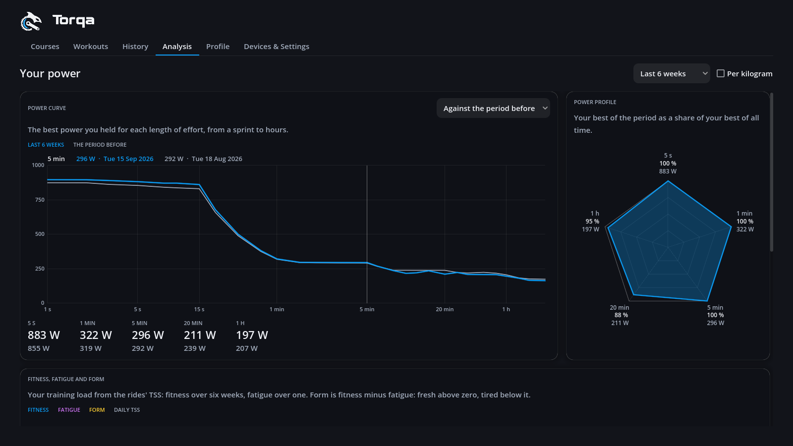
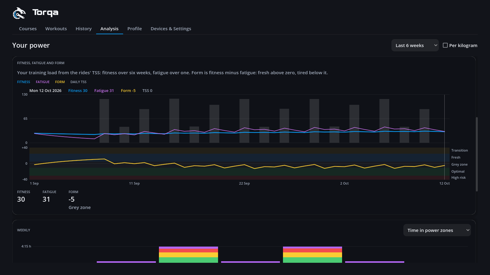
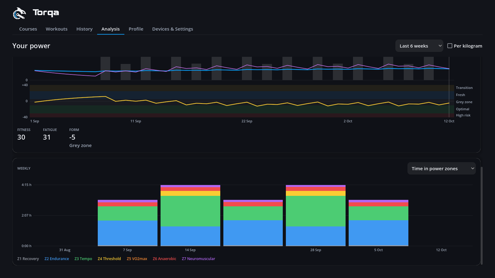
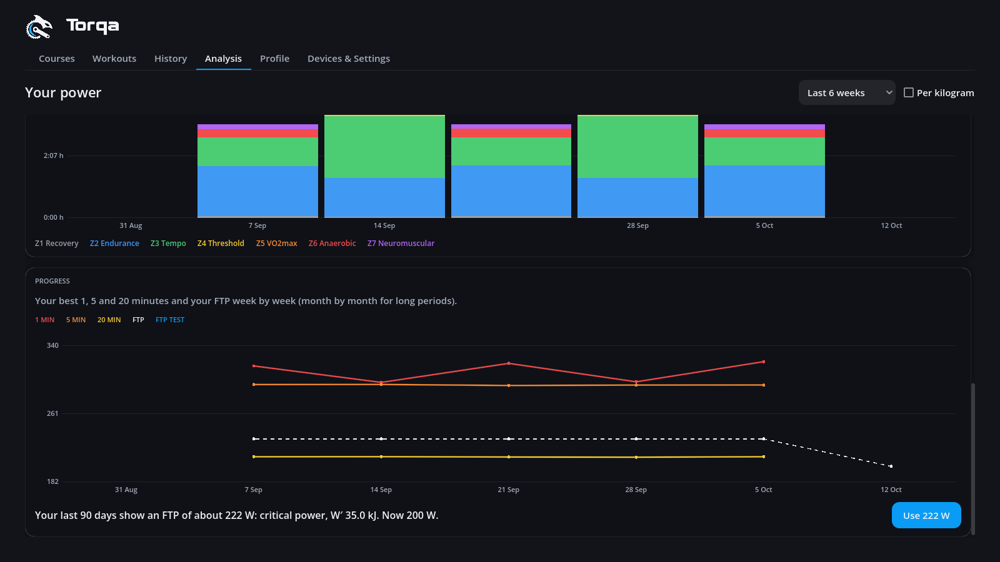

# Analysis

The **Analysis** tab on the start page looks at your power across all your rides, where the
[history](history.md) looks at one ride at a time. It shows the active rider's rides; switch
riders on the Profile tab. At the top, choose the **period** (the last 6 weeks, 90 days or 12
months, or all time); it applies to every section. **Per kilogram**, at the top of the power
profile, shows power in W/kg in the power curve, the profile and the progress.

## Power curve

The power curve shows the best average power you held for every length of effort: your best
5 seconds on the left, your best 20 minutes in the middle, your best hours on the right. The time
axis is logarithmic, so short efforts get as much room as long ones. Hover over the chart to
read off each curve at that duration, with the date of the ride it comes from.

- The curve in blue is the best of the rides in the period.
- **Compared with** (beside the title): in grey, the best of all your rides, or of the period
  just before (the 6 weeks before the last 6). Where the blue curve reaches the grey one, you are as strong as
  you have ever been; where it stays under it, there is form to win back.
- **Per kilogram** (beside the power profile): the curve in W/kg instead of watts, each ride
  with the weight you had then.
  Rides saved before Torqa kept the weight use your weight today.
- Under the chart: your best 5 s, 1 min, 5 min, 20 min and 60 min of the period, and of the
  rides compared with in grey.

Simulated rides (sped up or moved along with the fake trainer) count for nothing here: the
power was not yours.

## Power profile

Beside the curve, the power profile — the "power spider" — shows your best 5 seconds (sprint),
1 minute (anaerobic), 5 minutes (VO2max), 20 minutes (threshold) and hour of the period, each
as a share of your best of all time. The rim is your own best, so a full shape means you are as
strong as you have ever been everywhere, and a dent shows where there is most to win back.
Each corner gives the share and the period's best; "--" means no ride of the period lasted that
long. With **All time** chosen, the shape fills the rim.

The profile compares you with yourself only, not with other riders: it needs no age or sex and
no reference tables.

## Fitness, fatigue and form

Under the power, the fitness chart shows how your training adds up over the days of the period
— the performance management chart of TrainingPeaks and intervals.icu, computed in Torqa from
your rides:

- **Fitness** (blue) is your training load averaged over about six weeks (42 days), **fatigue**
  (purple) over about one week (7 days). Both count each ride's TSS on the day you rode it,
  with the most recent days weighing most; the grey bars are each day's TSS.
- **Form** (yellow, below) is yesterday's fitness minus fatigue: above zero you are fresh, below
  it tired. Its bands are named as intervals.icu names them: *Transition* (over +25: rested,
  losing fitness), *Fresh* (+5 to +25: ready to race), *Grey zone* (−10 to +5), *Optimal*
  (−30 to −10: training that builds fitness) and *High risk* (under −30).
- Under the chart: your fitness, fatigue and form today.
- Hover over the chart to read a day off.

Everything starts at zero before your first ride in Torqa, so fitness says little in the first
weeks. A shorter period still counts the rides before it. Rides without power have no TSS and
count as rest.

## Weekly

The weekly bars show each week (Monday to Sunday) of the period: riding **time**, **distance**,
**climbing**, **training stress** (TSS) or the number of **rides**, or the **time in power
zones** or **heart-rate zones**, stacked in the zones' colours. The zones are the rider's zones
today, as on a ride's summary, so they follow when you change your FTP or zones. Hover over a
bar for the week's figures.

## Progress

At the bottom, the progress chart follows your best 1 minute, 5 minutes and 20 minutes week by
week — month by month for periods longer than 13 weeks — with your FTP (dashed: the FTP each
ride was saved with) and the results of your FTP tests as dots. A gap means you did not ride
that long in that week or month.

### The FTP your rides show

Under the chart, Torqa estimates your FTP from your best efforts of the last 90 days, next to the
FTP in your profile, with **Use … W** to take it. It never changes your FTP by itself.

- With best efforts from 2 to 20 minutes that fit together, it is the **critical power** of
  Morton's three-parameter model, the power you could hold for a long time, fitted to those
  efforts as GoldenCheetah does. **W′** is the work you can do above it before you are spent.
  Efforts that cannot have been all-out — a best 10 minutes lower than your best 5 and 20
  minutes say you could hold — are left out of the fit.
- Otherwise it is 95 % of your best 20 minutes, as after the 20-minute test.
- It needs a ride of at least 20 minutes in the last 90 days.

The estimate is only as good as your best efforts: if you have not ridden hard for 3, 5, 10 or
20 minutes lately, it comes out low. An FTP test ([workouts.md](workouts.md)) gives a firmer
number.

## Records

A ride holding your best power over 5 s, 1, 5, 20 or 60 minutes gets a ★ for it on its summary
and in the history, e.g. *★ Best 5 min: 312 W*. Another ride beating it later takes the ★ over.

## How it is computed

Each ride keeps its best power over 36 durations, from 1 s to 8 h, and the seconds it spent at
each watt and each heartbeat per minute, in its summary file beside the FIT file, so the tab
reads no FIT files and the data syncs with the rides
([ADR 0014](adr/0014-ride-analysis-data.md)). Rides saved before this existed, and FIT files
copied in by hand, are read once the next time the history or this tab opens.

Days and weeks follow your computer's time zone as it is today; around a change to or from
summer time, a ride close to midnight may count for the day next to it. Seconds without power
count as 0 W. In FIT files from other apps or devices, power is taken
once per second; a gap of more than 10 s between records counts as a pause, and no effort spans
it.
