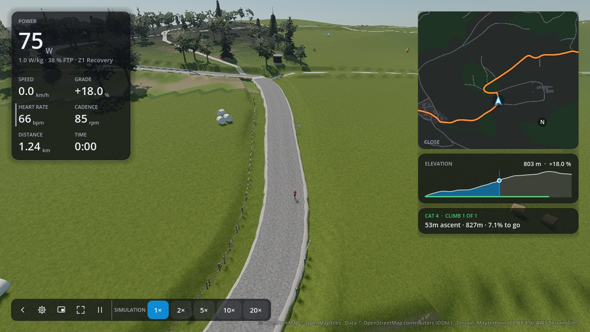
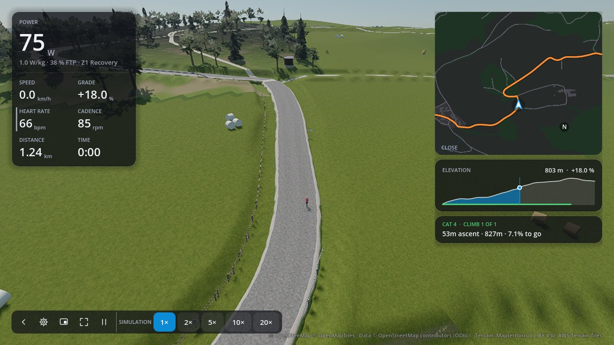
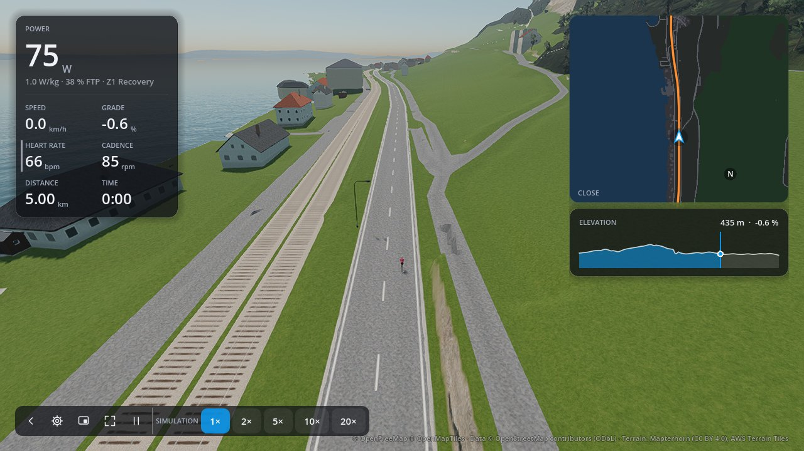
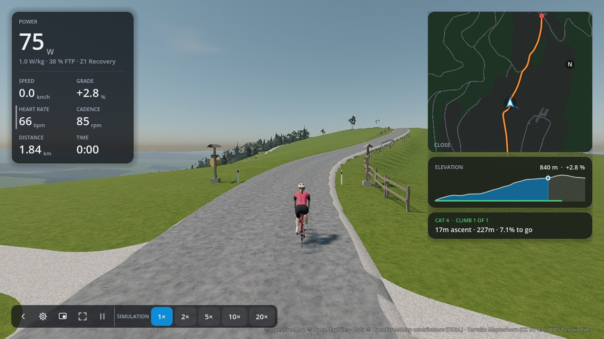

# Galaxy Tab S7 frame rate on Low

2026-11-16, Samsung Galaxy Tab S7 (SM-T870, Adreno 650, Android 13, 2560 × 1600), Godot 4.7.2
Mobile renderer, Low preset. Issue #542.

## Conditions

- Release builds of main 86f029f6, of the terrain fix (`perf/terrain-layers`) and of the terrain
  and sky fixes together, each as a side-by-side "ORQWA perf" APK whose main loop is
  `app/tools/measure_frames.gd` (settings from a file adb writes; GPU and CPU time per frame
  from the rendering server).
- Twann – Chasseral (bundled), chase camera, rider paused, at 2, 9 and 16 km. Three seconds per
  sample after settling. Each run started with the tablet cooled to ≤ 31 °C (AP sensor).
- Numbers are GPU milliseconds per frame. The tablet is GPU-bound (render CPU 2–7 ms), and
  Android paces frames to whole refreshes, so GPU time is the measure, not fps.
- Repeated with no screen stream on the tablet: every whole-frame figure below came out
  within 2.2 ms of the first run (main 101.9 / 89.8 / 115.2, terrain 92.9 / 73.3 / 102.2,
  terrain + sky 88.1 / 67.2 / 97.5).

## Whole frame

| GPU ms | 2 km | 9 km | 16 km |
|---|---:|---:|---:|
| main | 104.1 | 89.8 | 113.9 |
| terrain layers | 93.2 | 72.8 | 103.1 |
| terrain layers + sky passes | 88.0 | 67.3 | 97.1 |

## What each part costs (frame minus frame without it)

| GPU ms | main | terrain | terrain + sky |
|---|---:|---:|---:|
| terrain, 2 / 9 / 16 km | 23 / 42 / 33 | 13 / 26 / 23 | 18 / 33 / 28 |
| sky (flat colour instead), 2 / 9 / 16 km | 12 / 11 / 11 | 13 / 8 / 9 | 6 / 2 / 3 |
| sky lighting redrawn as clouds drift | ~1 | ~1 | 0 |
| trees, 2 / 16 km | 18 / 27 | 12 / 28 | 19 / 29 |
| small plants, 2 / 16 km | 6 / 8 | 3 / 7 | 7 / 8 |

The "without it" figures shift when another part gets cheaper (a tiler's costs overlap), so
read them as the size of each part, not as savings that add up.

## Trees in 160 m cells on Low

Probes on the terrain + sky build, each changing one thing at run time (GPU ms saved at
2 / 9 / 16 km):

| Change | Saved |
|---|---:|
| all trees hidden | 19 / 2 / 29 |
| foliage drawn opaque (no alpha cut-out) | 15 / 1 / 22 |
| trees cast no shadows | 7 / 0 / 12 |
| sun shadows off | 15 / 4 / 19 |
| one shadow split instead of two | 5 / 1 / 6 |
| no backlight, no seasons, no anisotropic filtering or no flutter in the foliage shader | ≤ 2 |
| tree LOD bias 0.5 or 0.25, tree range 400 or 300 m, no range fade | ≤ 2 |
| trees in 160 m cells | 5 / 0.5 / 10 |
| 160 m cells and tree LOD bias 0.5 | 7 / 1 / 14 |
| … and trees cast no shadows | 8 / 1 / 14 |

Nearly all of the trees' cost is the cut-out: a fragment that may be discarded keeps the tiler
from rejecting hidden fragments early, so every layer of cards behind the first is shaded. The
shader's arithmetic hardly counts. Low batched its trees by 480 m chunk, and Godot chooses one
level of detail per batch from its closest point, so the tree LOD bias did nothing and every
tree near the route drew its full set of cards. In 160 m cells far trees take their coarser
levels, whose fewer, larger cards cut the overdraw in the view and the shadow map alike;
with them, dropping tree shadows saves little more, so shadows stay.

Low now uses 160 m cells, as the other presets did, with a tree LOD bias of 0.5. The build
measured as above:

| GPU ms | 2 km | 9 km | 16 km |
|---|---:|---:|---:|
| terrain layers + sky passes | 88.1 | 67.2 | 97.5 |
| + trees in 160 m cells on Low | 80.3 | 66.8 | 84.1 |

Trees now cost 12 / 16 ms at 2 / 16 km (was 19 / 29, frame minus frame without trees).
Render CPU rose from 3.1–3.5 to 4.0–4.6 ms (285 instead of 176 draw calls at 2 km), far below
the GPU time. Native renders of Low before and after differ in ≤ 1.8 % of pixels, in distant
crowns:

| Before | After |
|---|---|
|  |  |
|  |  |
|  |  |

## What is left

Terrain (~20–30 ms), sun shadows (~15–20 ms), trees (~12–16 ms, mostly the cut-out cards'
overdraw), small plants (~8 ms) and the ~27 ms floor of a frame with no 3D world (interface,
post-processing).
