# Road bike appearance (R227–R229)

Both rider sizes use coherent road-frame dimensions before the rider is posed. The saddle
height follows the rider's legs; the torso and arms are fitted to the frame's fixed hoods.
Painted frame tubes are welded and rounded before export, and the fork is joined afterward
so its crown and lower headset remain separate parts of the steering assembly.

Paint uses a non-metallic clear coat, carbon rims/cockpit/seat post use satin reflection,
tyre tread and casing remain rough, and steel and anodized hardware use metallic reflection.
The palette retains rider and group accent colours. The bike has thinner crossed spokes,
valve stems, vented rotors, open cassette sprockets, a continuous chain with separate side
plates, an open derailleur cage and a shaped bottle in its cage. Both saddles have compact
21 cm shells, shortened from 26 cm, and matching shorter rails. No third-party asset or
texture is added.

## Frame proportions

`art/riders/bike_fit.py` uses the published
[Aethos 49/54 geometry](https://www.specialized.com/us/en/s-works-aethos-sram-red-etap-axs/p/216931)
as a dimensional reference for the unbranded small/medium frames. Each has a round headset,
a 6° rising stem, compact drops and upright shifter horns. Fork offset is perpendicular to
the steering axis. The frame's dimensions determine clearance and contact points together.

| Dimension | Small (female) | Medium (male) |
|---|---:|---:|
| Stack | 514 mm | 544 mm |
| Reach | 375 mm | 384 mm |
| Head tube | 109 mm | 137 mm |
| Stem | 80 mm | 100 mm |
| Bar width | 380 mm | 420 mm |
| Built wheelbase | 975 mm | 979 mm |

The bar has a 75 mm reach and 125 mm drop. The tyres remain 28 mm, on lighter 35 mm carbon
rims. These proportions replace the cramped cockpit and its steep descending stem. The
frame, hands, hips and hubs are exported with a consistent fit manifest; animation node and
bone names are retained. Reference photographs are not bundled.

## Matched visual review

The original and revised assets below use identical cameras, atmospheric sky, midday energy,
AgX tone mapping and FXAA. The rider review tool previously used the retired gradient sky
and linear tone mapping; its lighting now follows the riding view's material response.

| Original | Revised |
|---|---|
| 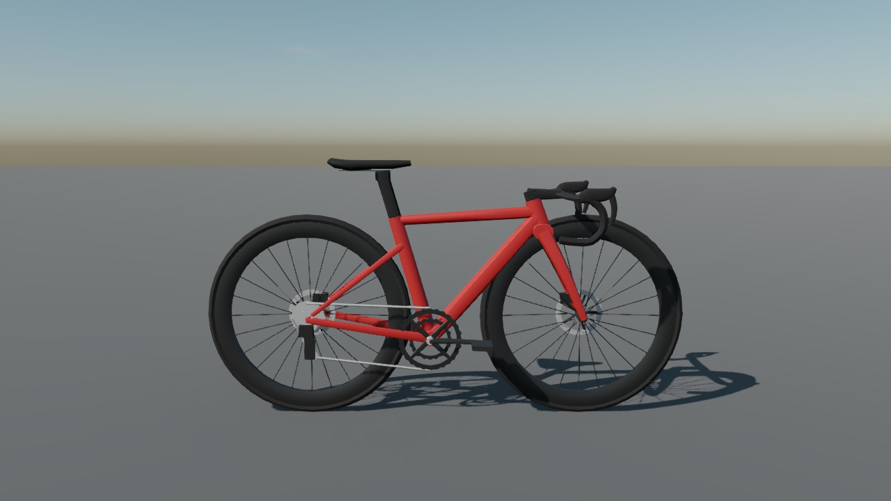 | 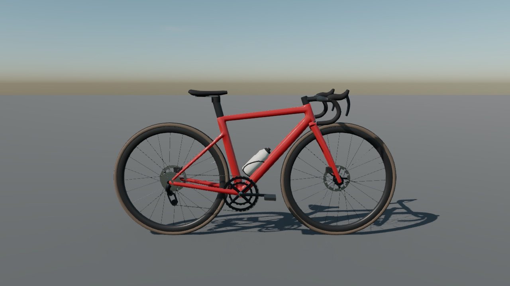 |
| 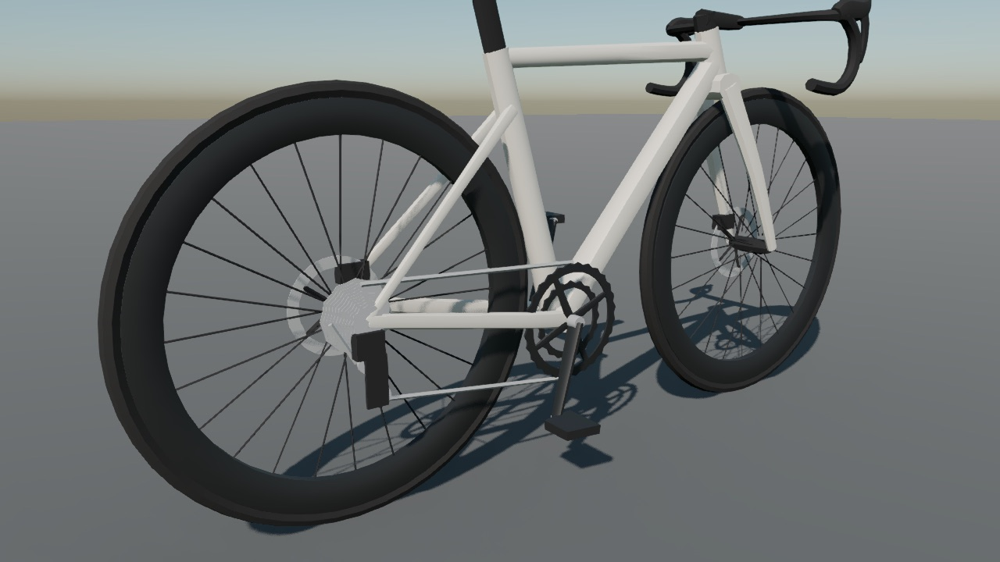 | 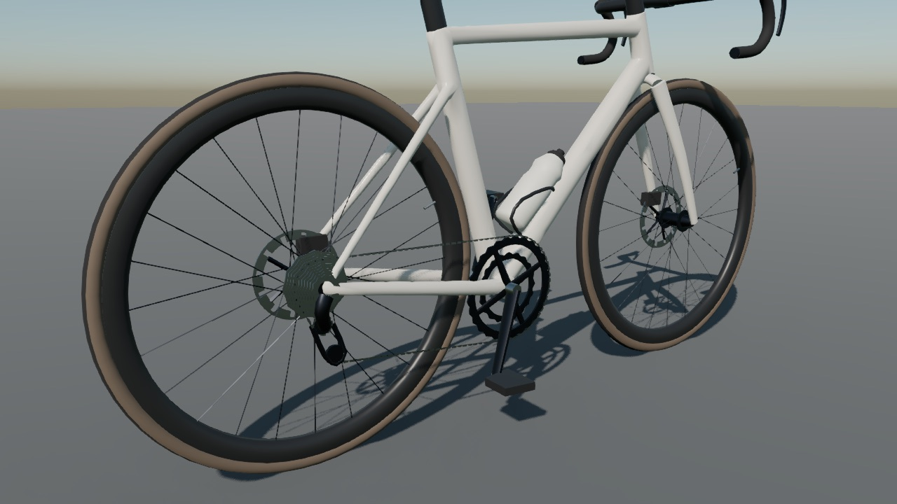 |

The [rider gallery](../art/README.md#riders) includes both rider fits seated, standing,
leaning, from the chase camera and in bike-only side, drivetrain, front, cockpit, wheel
clearance and saddle views. The rebased models retain main's current road-racing helmets.

| Female frame clearance | Male frame clearance |
|---|---|
| 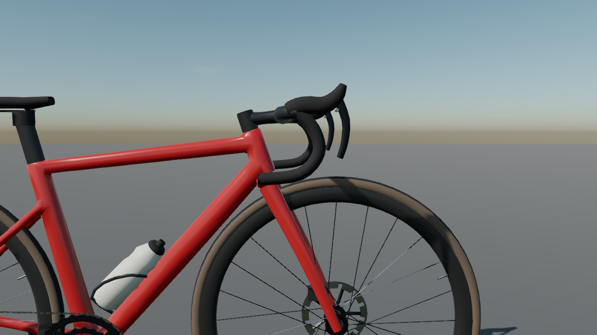 | 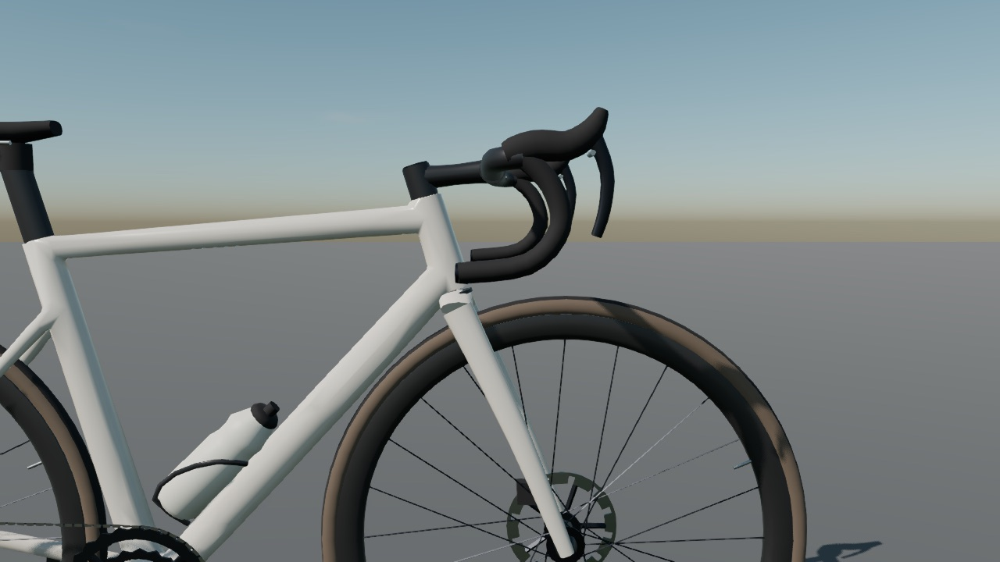 |

| Female saddle | Male saddle |
|---|---|
| 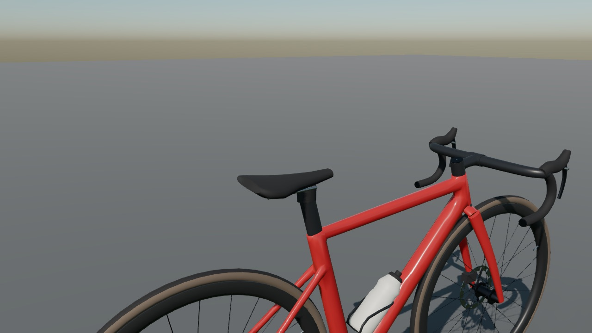 | 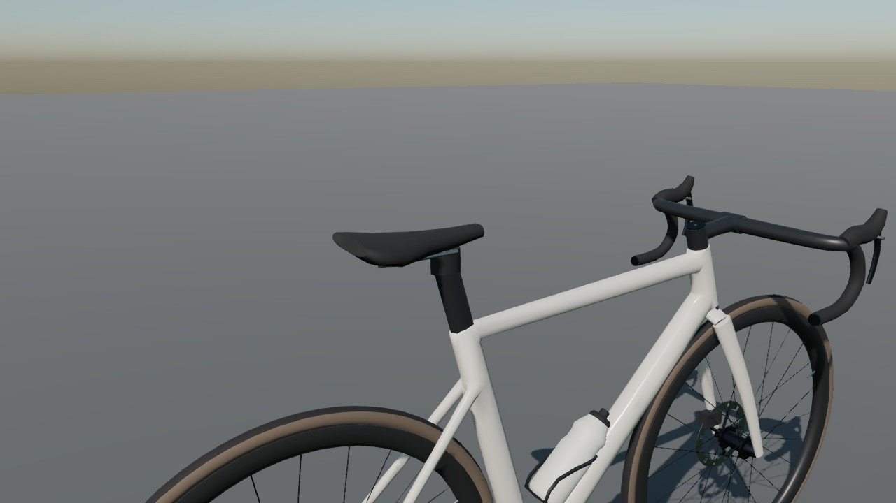 |

The bundled Twann–Chasseral course at 4,200 m, built from its saved inputs:

| Chase | First person |
|---|---|
| 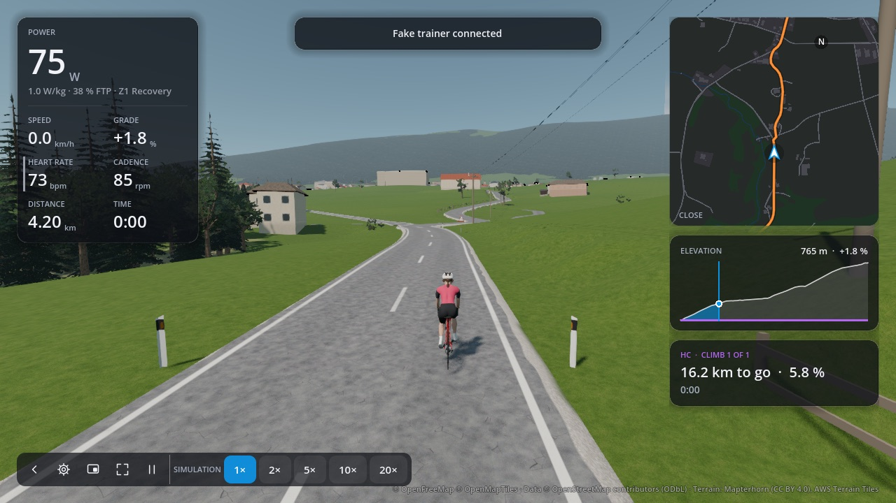 | 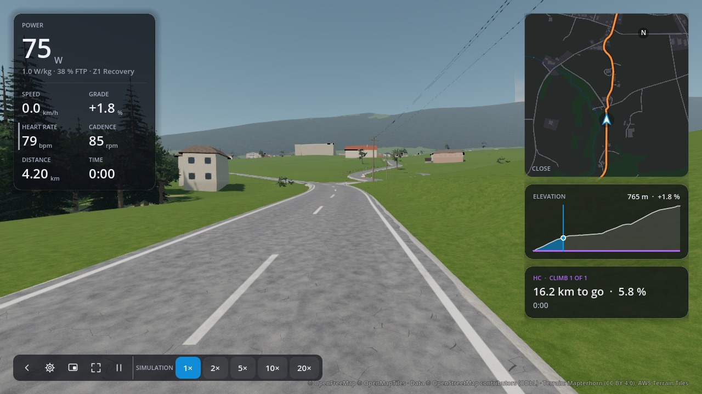 |

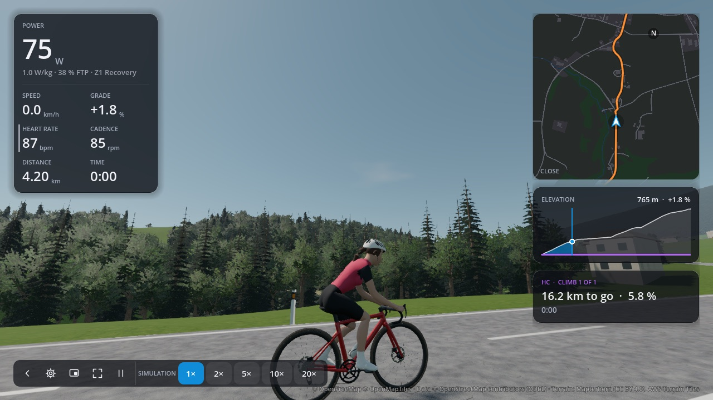

## Asset and rendering contract

- `art/riders/build.py` remains the source, with both generated GLBs committed. Only painted
  main-frame faces enter the 3 mm voxel weld and smoothing; their surface is reduced to 1,800
  triangles before rejoining the fork and hardware.
- The six bike nodes, skeleton and fit-manifest fields stay stable. The updated hips, hoods,
  hubs and rest pose are rebuilt together. The chain
  stays in the frame mesh; it adds no animated link nodes. Course generation and stored-world
  formats are unchanged.
- `RiderAvatar` styles the new `sidewall`, `carbon`, `alloy` and `bottle` materials from the
  `bike` palette alongside the existing material names. A frame still receives its rider or
  group accent; ghost transparency and body hiding use the existing presentation path.
- The complete bike is 18,036 triangles, compared with about 9.8k previously. The whole
  rider and bike grows by about 16%. In the fixed side view, visible draw calls rise from 19
  to 24 for the bike alone and from 29 to 34 with a rider. These are software Vulkan counts,
  not native GPU frame-rate measurements. The 60 fps Medium target on a base M1 still needs
  measurement on that hardware.

## Reproduction

Run in the art/dev containers, with renders and checks in separate runs:

```sh
scripts/art.sh blender --background --factory-startup --python art/riders/build.py
scripts/dev.sh sh -c 'GALLERY=docs/images/models scripts/render-riders.sh'
scripts/dev.sh sh -c 'VIEWS="bike-side bike-drive bike-front bike-cockpit" scripts/render-riders.sh'
scripts/dev.sh sh -c 'VIEWS="bike-clearance bike-saddle" scripts/render-riders.sh'
scripts/dev.sh sh -c 'COURSE=core/orqwa-gd/courses/twann-chasseral.oqc SHOTS="bike-chase:4200:0 bike-first-person:4200:1 bike-road-side:4200:0:3,1.2,1" scripts/render-views.sh'
scripts/dev.sh scripts/check.sh
make wiki-check
```

The runner prints visible draw calls and primitives for each view. Review fork/tyre
clearance, frame openings, casing/tread transitions, cockpit surfaces, drivetrain continuity
and seated/standing contact points. The existing `rider_smoke.gd` checks full-turn leg reach,
standing motion, hand placement, coasting and first-person body hiding.

## Initial validation (2026-11-07, before the rebase and fit corrections)

- Repeated Blender builds produced byte-identical GLBs and fit metadata. The fit manifest is
  unchanged from the original assets.
- The initial 26 rider/bike views and three saved-course views were reviewed.
- A runtime compatibility check verified every imported material's rider/group colour and
  ghost transparency for both rider sizes.
- `scripts/check.sh` passed: Rust formatting, Clippy, workspace tests, dependency checks,
  GDScript lint/format, and all Godot smoke/render checks, including rider animation.
- `make wiki-check` passed.

## Review of reference-sized frames

Both models and their fit metadata are rebuilt around the reference frames, retaining the
current helmet geometry. All 34 gallery views and the three saved-course views are refreshed
and visually reviewed, including the cockpit, frame clearance, saddles, seated reach and
standing poses. Automated tests were not rerun for these revisions.
