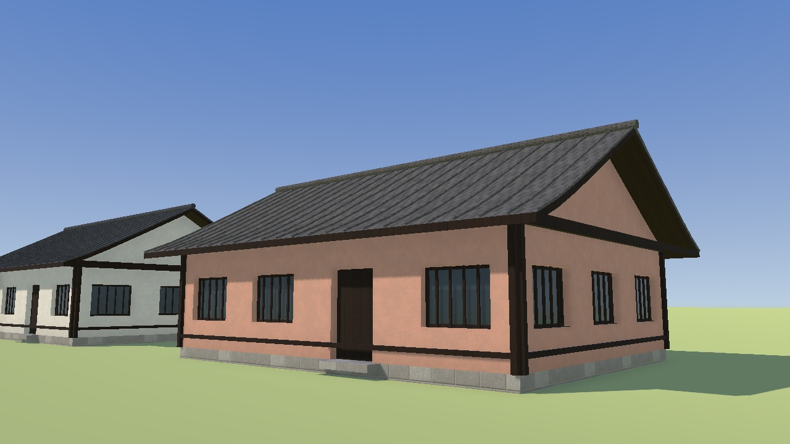
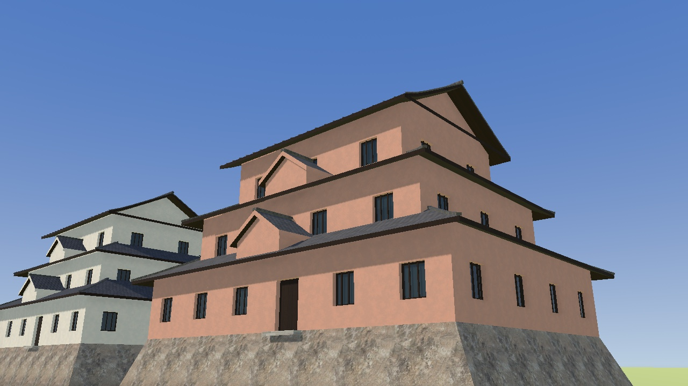

# Regional buildings

The Asian starter set (R164, [ADR 0035](adr/0035-regional-buildings.md)) adds six houses
and three castle keeps. Its East Asian models use Japanese architectural references. Source
geometry is in `art/buildings/japanese.py`; catalogue entries and exported GLBs use the
`japanese_house` and `japanese_castle` kinds.

Houses have pale plaster, exposed dark timber, recessed glazing with wooden mullions,
deep ceramic-tiled eaves and raised ridge caps. Two-storey houses add a tiled entrance-side
canopy. Castle keeps have a battered stone base, three or five receding roof tiers and a
gabled upper roof, with projecting gables on broad lower tiers. They share the existing
plaster, wood and roof-tile materials; platforms reuse the natural-rock scan through the
`castle_stone` material name, while houses retain masonry plinths.
These models are own-work regional archetypes, not copies of particular monuments.

Architectural references consulted for proportions and materials:

- [Naramachi traditional house guide](https://naramachi-nigiwainoie.jp/english/wp-content/uploads/2018/11/machiya_guide_english.pdf):
  tiled roofs and timber lattice on town houses.
- [Himeji Castle history](https://www.himejicastle.jp/en/guide/history/):
  plastered timber keeps and tiled roofs.
- [Japan Tourism Agency: Himeji roof tiles](https://www.mlit.go.jp/tagengo-db/en/R1-00664.html):
  flat and cylindrical tile construction. No reference images or other assets are redistributed.

## Placement

`buildings/region.rs` classifies each footprint centroid using bundled country outlines for
the UN M49 Asia region from country-coder. See [data provenance](../core/orqwa-world/data/README.md).
This is a coarse regional heuristic, separate from climate and inferred building use. It does
not identify actual historic buildings.

Non-tropical houses use the regional house set; tropical lowlands retain their flat/red-tiled
houses. Regional houses have eight warm, pale, green, blue, rose and ochre wall colours, and
six charcoal, red, green and blue-gray roof colours. Altitude no longer introduces Swiss
chalets or farmhouses in Asia. Modern building kinds retain their current models. Mapped
castles select tiered keeps, without adding castles where
the map marks none. Fit limits remain ±25%; shops, steep plots and unsuitable footprints
use shells. House shells have pale walls and charcoal roofs; castle shells retain receding
roof tiers, including at distance. Detailed timber lattice and curved eaves belong to the
nearby models.

Generator 37 changes placement and shells; existing kept worlds remain readable and offer
regeneration. Model names and the instance buffer contract are unchanged for existing assets.
No course input changes or new network requests are needed.

## Rebuild and review

Run the existing Blender pipeline, naming the new models to leave other assets untouched:

```sh
scripts/art.sh blender --background --factory-startup --python art/buildings/build.py -- \
  japanese_house_1_s japanese_house_1_m japanese_house_2_s japanese_house_2_m \
  japanese_house_2_l japanese_house_hipped_1_m \
  japanese_castle_3_s japanese_castle_3_m japanese_castle_5_l
```

The [model gallery](../art/README.md#buildings) shows the actual Godot materials in three
variants. `MODELS` limits `scripts/render-models.sh`; use `GALLERY=docs/images/models` when
refreshing committed pictures. Review both the overview and the eye-height close-ups.
Keep ordinary houses within 5,000 triangles and keeps within 10,000.

| House at riding height | Three-tier castle keep |
|---|---|
|  |  |

Tests cover East, Southeast, South, Central and West Asian locations, nearby countries,
tropical precedence, bounded model fitting, mountain houses, and complete offline world
generation with mapped castles.
The fallback-shell test checks receding keeps on both narrow and concave outlines.
The full `scripts/check.sh` suite and `make wiki-check` pass. Rebuilding all nine models
produces byte-identical GLBs and manifest. Exported houses contain 1,526–4,786 triangles
across five material surfaces; keeps contain 3,276–7,952 across six. The nine GLBs total
2,412,496 bytes.

Native ride performance on an M1 at Medium remains a manual check; software renders do not
establish that frame-rate budget. More locally distinct regional sets and house types remain
future work.
