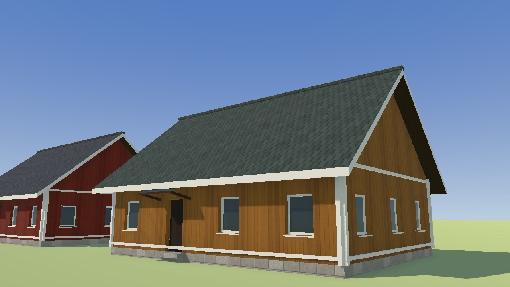
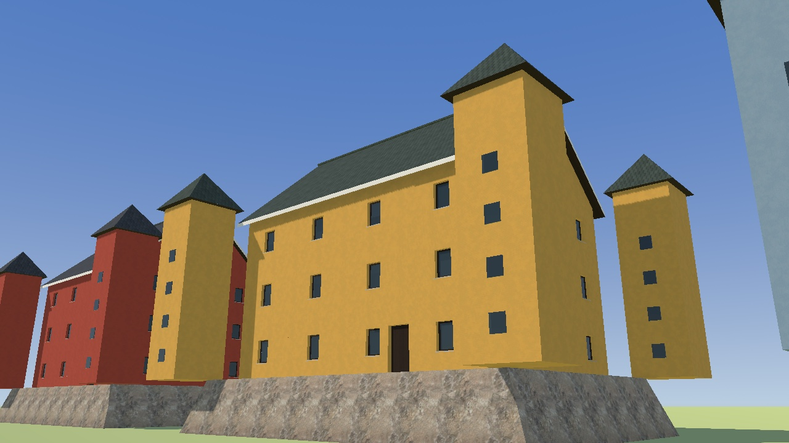

# Regional buildings

The regional sets (R164, [ADR 0035](adr/0035-regional-buildings.md)) add six East Asian
houses and three tiered castle keeps, four Nordic painted-timber houses and three stone keeps,
plus four French village houses, two Haussmann-inspired apartment houses and three
château-inspired keeps. The East Asian models use Japanese architectural references. Source
geometry is in `art/buildings/japanese.py`,
`art/buildings/nordic.py` and `art/buildings/french.py`; catalogue entries and exported GLBs
use their corresponding regional model kinds.

Asian houses have exposed dark timber, pale or coloured walls, recessed glazing, deep swept
tiled eaves and ridge caps. Two-storey houses add a tiled entrance-side canopy. Their castle
keeps have a battered stone base and three or five receding roofs. Nordic houses use tinted
plank siding, bright trim, simple mullioned windows and steep gabled tile roofs. Nordic keeps
have stone platforms, coloured plaster walls, four projecting corner towers and steep roofs.
Both sets reuse existing materials and textures; platforms use the `castle_stone` material
and existing natural-rock scan. These are own-work archetypes, not copies of particular
monuments.

French houses use light plaster, stone bases, shutters and hipped roofs in slate and tile
colours. Tall French residential blocks use pale stone façades, tall windows, continuous iron
balconies on the second and fifth floors and zinc mansard roofs with dormers. French keeps use
stone walls, slate roofs and four roofed corner pavilions. These starter forms are inspired by
French village houses, Haussmannian apartments and châteaux; they do not represent the full
range of architecture across France.

Architectural references consulted for proportions and materials:

- [Naramachi traditional house guide](https://naramachi-nigiwainoie.jp/english/wp-content/uploads/2018/11/machiya_guide_english.pdf):
  tiled roofs and timber lattice on Japanese town houses.
- [Himeji Castle history](https://www.himejicastle.jp/en/guide/history/): plastered timber keeps
  and tiled roofs; [Japan Tourism Agency: Himeji roof tiles](https://www.mlit.go.jp/tagengo-db/en/R1-00664.html)
  describes flat and cylindrical tile construction.
- [Nordiska Museet: Härkeberga](https://www.nordiskamuseet.se/en/visit-us/our-destinations/harkeberga/):
  a central Swedish farmstead with red timber buildings.
- [Visit Sweden: traditional red houses](https://visitsweden.com/about-sweden/swedish-red-houses/):
  Falun red paint and its protective use on timber facades.
- [Visit Denmark: De Gamle Huse](https://www.visitdenmark.se/danmark/planera-resan/maribo-open-air-museum-gdk789901):
  traditional timber-framed houses in Lolland-Falster. No reference images or other assets
  are redistributed.
- [French Ministry of Culture: Normandy timber framing](https://www.culture.gouv.fr/Media/medias-creation-rapide/dp_jep_2025_normandie.pdf):
  timber frames with brick, flint or earth infill.
- [Château de Versailles: Louis Le Vau](https://en.chateauversailles.fr/discover/history/great-characters/louis-vau):
  slate roof use in French château architecture.
- [City of Paris: Haussmann and the modern city](https://www.paris.fr/pages/haussmann-l-homme-qui-a-transforme-paris-23091):
  the continuous fifth-floor balcony and apartment-building proportions.

## Placement

`buildings/region.rs` classifies each footprint centroid using bundled country outlines.
Asian coverage follows UN M49 region 142 and Nordic outlines come from country-coder. Nordic
coverage names Denmark,
Finland, Iceland, Norway and Sweden, plus the Faroe Islands, Åland, Svalbard and Jan Mayen;
Greenland and the rest of Northern Europe stay generic. French coverage uses a simplified
metropolitan France and Corsica outline; overseas France and other Francophone countries
stay generic. See [data provenance](../core/orqwa-world/data/README.md).
The classifier is a coarse regional heuristic, separate from climate and inferred building
use. It does not identify actual historic buildings.

Non-tropical houses use their region's set; tropical lowlands retain their flat/red-tiled
houses. Asian houses have eight pastel, earth and cool wall colours and six dark, red, green
and blue-gray roof colours. Nordic houses have seven red, ochre, cream, green and blue wall
colours and five matching roof colours. French houses have six light or muted wall colours
and five slate or terracotta roof colours. French city houses have five limestone colours and
four zinc roof colours. Asian, Nordic and French mountain houses do not become Swiss chalets
or Bernese farmhouses. Modern building kinds retain their existing models.

Mapped Asian castles select tiered keeps; mapped Nordic castles select four-tower keeps;
mapped French castles select château-inspired keeps. Tall French residential blocks select
five- or six-storey Haussmann-inspired apartments.
Other mapped castles retain their existing European models. No castle is added where the map
marks none. Fit limits remain ±25%; shops, steep plots and unsuitable footprints use shells.
Regional colours survive in the shells; Asian castle shells keep receding roof tiers, and
Nordic castles use the general stone keep shell at distance; French shells retain their
stone walls and roof colours.

Generator 39 changes placement and shells; stored format 3 remains unchanged and older kept
worlds can be regenerated. Existing model names and instance-buffer contracts remain valid.
No course input changes or new network requests are needed.

## Rebuild and review

Run the existing Blender pipeline, naming the new models to leave other assets untouched:

```sh
scripts/art.sh blender --background --factory-startup --python art/buildings/build.py -- \
  japanese_house_1_s japanese_house_1_m japanese_house_2_s japanese_house_2_m \
  japanese_house_2_l japanese_house_hipped_1_m japanese_castle_3_s \
  japanese_castle_3_m japanese_castle_5_l \
  nordic_house_1_s nordic_house_1_m nordic_house_2_m nordic_house_2_l \
  nordic_castle_3_s nordic_castle_3_m nordic_castle_4_l \
  french_house_1_s french_house_1_m french_house_2_m french_house_2_l \
  french_castle_3_s french_castle_3_m french_castle_4_l \
  french_city_5_m french_city_6_l
```

The [model gallery](../art/README.md#buildings) shows the actual Godot materials in three
variants. `MODELS` limits `scripts/render-models.sh`; use `GALLERY=docs/images/models` when
refreshing committed pictures. Review both the overview and the eye-height close-ups. Keep
ordinary houses within 5,000 triangles, city houses within 10,000 and keeps within 10,000.

| Regional painted-timber houses | Regional castles |
|---|---|
|  |  |

Tests cover Asian, Nordic and French outlines, neighbouring countries, tropical precedence,
bounded model fitting, mountain houses, French city blocks, regional palette variety and
complete offline world generation with mapped castles. The Asian fallback-shell test checks
receding keeps on narrow
and concave outlines. The full `scripts/check.sh` suite and `make wiki-check` pass.

Native ride performance on an M1 at Medium remains a manual check; software renders do not
establish that frame-rate budget. More locally distinct architecture within the Asian and
Nordic sets remains future work.
