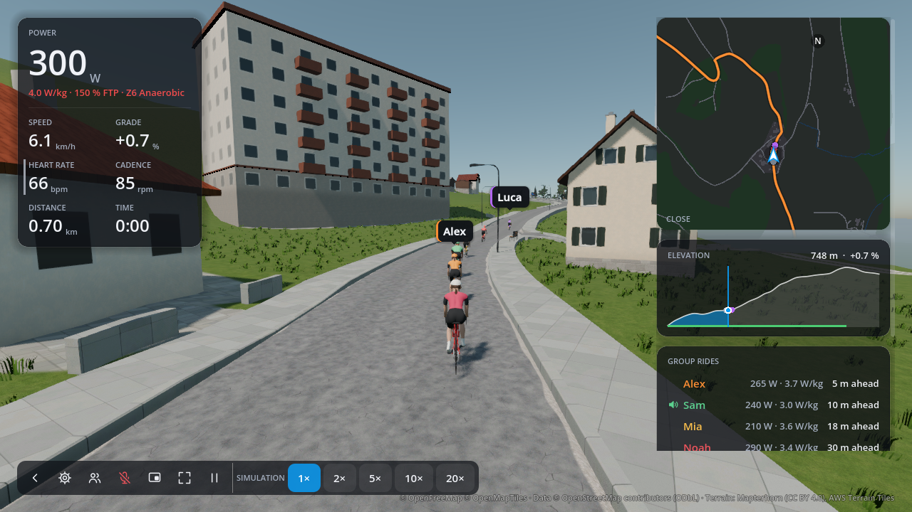

# Ride layout review

Review prototype for a ride screen that fits a 1280 × 720 window, using ORQWA's
existing Godot controls and theme. These are application renders, not generated
mockups. The normal ride scene is unchanged; this proposal is not yet shipped.

## Current layout

The 300-pixel-tall map, elevation profile and seven group rows leave the active
climb below the visible part of the right column. Reaching it requires scrolling.

## Proposed layout

- Keep the existing metrics, controls, fonts, colors and translucent panel style.
- Shorten the map and elevation profile, and reduce the gaps between panels.
- Place the active climb immediately after the full-tour elevation profile.
- Keep the climb title, followed by one body line in a uniform text size:
  **Remaining: 112m ascent · 1.4km · 7.1% average**. No arrow, emoji or separate
  timing line.
- Rename the in-ride group panel to **Riders**, without a rider count, column
  headings or legend. Align names, watts, W/kg and gaps in columns, separated only
  by space: `Alex  265W  3.7 W/kg  5m ahead`. Keep **ahead** or **behind** on every
  gap, identity colors and speaking icons. There are no comma or slash separators;
  the unit **W/kg** retains its standard spelling.
- Show all seven other riders and the climb together without scrolling.

The new **112m** ascent value is illustrative presentation data. The
other climb values come from the existing ride state. Shipping the feature needs
a Rust calculation of positive ascent between the rider and the active climb's
end, exposed through the climb state; Godot should only format that value.

## Capture and follow-up

Both images use the same frozen Gurtenstrasse course scene at 700 m, chase camera,
seven-peer presentation fixture and 1280 × 720 viewport. The proposal is applied
after the baseline capture, within the same Godot process. The current HUD metrics
and bottom controls are retained. No networked group or microphone is opened.

Rendering uses the devcontainer's Godot and software Vulkan pipeline, as described
in the `orqwa-render-review` skill, with the existing `GroupRiderScreenshots`
fixture as the starting point. The container uses an isolated application data
directory and the ORQWA 0.6.1 GDExtension built during repository verification;
the application source and assets are from revision `cb8e1f4a`.

The final proposal's right column is 350 px wide, with 8 px between panels. Its
map, profile, climb and Riders panels are respectively 148, 110, 58 and 236 px
tall; the last panel ends at y = 600 px. Both saved images are 1280 × 720.

Before the final wording selection, validation passed: the full `scripts/check.sh`
suite, wiki validation, the scratch fixture's GDScript lint/parse checks and render
panel bounds assertions. The selected wording was rendered afterward; no further
tests were run, as requested.

The scratch fixture and render logs are retained in the task worktree's ignored
`screenshots/ride-layout/` directory. The fixture can be copied back to
`app/tests/tmp_ride_layout.gd` for further visual iteration, then run in the
devcontainer with the same software Vulkan/Xvfb setup as `scripts/screenshots.sh`.

Review the layout before implementing it in the application. Production work must
also cover solo rides, workouts on a course, ghost feedback, longer translated
labels, long rider names, imperial units, resizing and customized HUD layouts.
This prototype establishes the full-group landscape layout, rather than proving
every combination of those states fits.
