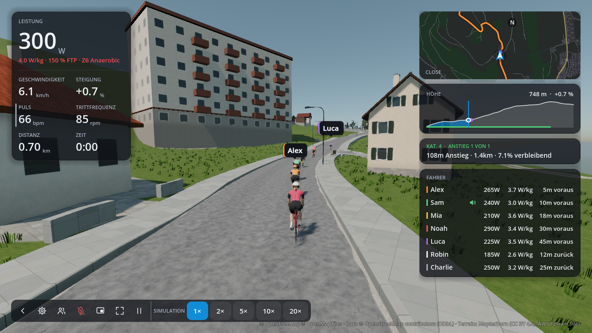

# Ride screen layout

The ride screen keeps the active climb and all seven other riders visible at
1280 × 720, using ORQWA's existing Godot controls and theme.

## Before and after

The original 300 px map and scrolling column pushed the climb below the visible
part of a full group's rider list.

The implemented layout places the map, full-course elevation profile, active
climb and **Riders** in that order. The map and profile adapt to available height;
the column does not scroll. Workout targets follow the metrics on the left, and
a large selection of HUD figures can use extra columns without changing the
rider's saved order. Ghost feedback remains below Riders.

The climb keeps its title and uses one uniformly sized line, for example
**108m ascent · 1.4km · 7.1% to go**. German ends in **verbleibend**, without an
English-style prefix or an average suffix. There are no arrows, emojis or separate
timing figures. The gradient remains the climb's average gradient.

**Riders** shows aligned name, watts, W/kg and gap columns, with identity colors
and speaking indicators. Every gap says **ahead** or **behind**. There are no
column headers, rider count, legend, comma or slash separators; **W/kg** retains
its standard unit spelling. Long names are ellipsized with the full name in a
tooltip. Column widths are shared across riders, including when gap lengths vary.

## Remaining climb ascent

Rust calculates positive elevation gain between the current distance and the
active climb's end, including partial segments and intermediate dips. It excludes
later climbs and never subtracts a descent from uphill work still ahead.
`ClimbProgress.remaining_ascent` is exposed as `remaining_ascent_m` in the
Godot climb dictionary. Godot converts metres to feet for imperial riders and
formats the one-line summary. No scenery or networking format changes are needed.

## Rendering and validation

The current images use the implemented ride scene, a Gurtenstrasse course at
700 m, the chase camera and the existing seven-peer presentation fixture. The
remaining climb ascent comes from the Rust route data, replacing the proposal's
sample value. English, German and solo ride captures use the same frozen scene.
The original image is retained for comparison.

The Rust extension was built and these screenshots were captured through the
devcontainer's Godot/software Vulkan pipeline. No further tests were run, as
requested. Route coverage was added for partial segments, intermediate descents,
climb-end bounds and empty intervals; existing rider UI expectations were updated.
Those tests have not been run for this implementation. The earlier proposal's
passing test run does not validate these application changes.

The scratch capture fixture and logs remain in the task worktree's ignored
`screenshots/ride-layout/` directory.
