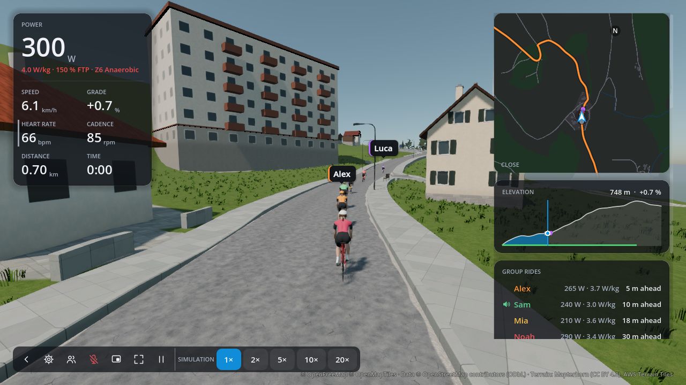
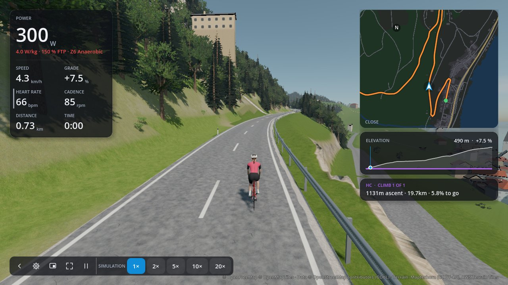
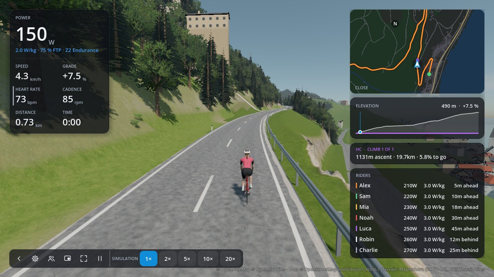
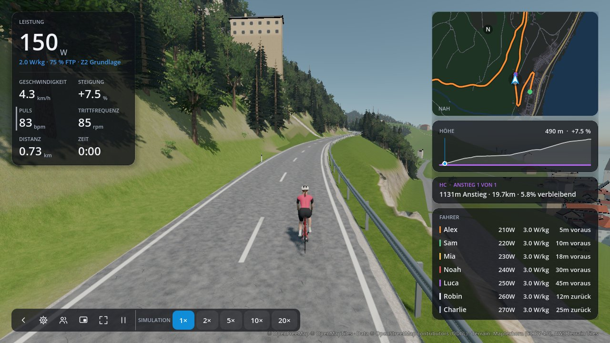

# Ride screen layout

The ride screen keeps the active climb and all seven other riders visible at
1280 × 720, using ORQWA's existing Godot controls and theme.

## Before and after

The original 300 px map and scrolling column pushed the climb below the visible
part of a full group's rider list.

The implemented layout places the map, full-course elevation profile, active
climb and **Riders** in that order. The map and profile adapt to available height;
the column does not scroll. On a course, workout targets follow the metrics on
the left, and a large selection of HUD figures can use extra columns without
changing the rider's saved order. Ghost feedback remains below Riders.

A workout ridden without a course has no map, profile or climb, so its targets
lead the right column instead and the metrics keep their full height (R253).

The map grows to 300 px whenever the visible panels leave enough room, including
on small screens during solo rides (#617, R247). It shrinks only as much as the
profile, climb, riders and ghost need, then grows again when those panels shrink
or disappear. Resizing the window recalculates the same available space.

The climb keeps its title and uses one uniformly sized line, for example
**108m ascent · 1.4km · 7.1% to go**. German ends in **verbleibend**, without an
English-style prefix or an average suffix. There are no arrows, emojis or separate
timing figures. The gradient remains the climb's average gradient.

**Riders** shows aligned name, watts, W/kg and gap columns, with identity colors
and speaking indicators. Every gap says **ahead** or **behind**. There are no
column headers, rider count, legend, comma or slash separators; **W/kg** retains
its standard unit spelling. Long names are ellipsized with the full name in a
tooltip. Column widths are shared across riders, including when gap lengths vary.

## Remaining climb ascent

Rust calculates positive elevation gain between the current distance and the
active climb's end, including partial segments and intermediate dips. It excludes
later climbs and never subtracts a descent from uphill work still ahead.
`ClimbProgress.remaining_ascent` is exposed as `remaining_ascent_m` in the
Godot climb dictionary. Godot converts metres to feet for imperial riders and
formats the one-line summary. No scenery or networking format changes are needed.

## Rendering and validation

The current images use the implemented ride scene, the bundled Twann–Chasseral
course at 730 m, the chase camera and seven-peer presentation fixtures. Remaining
climb ascent comes from the Rust route data. English, German and solo captures use the
same frozen scene through the devcontainer's Godot/software Vulkan pipeline.
The original image is retained for comparison.

Layout verification covers English and German at 1024 × 640, 1280 × 720 and
1600 × 900, with zero, one and seven peers, with and without a ghost, including
returning to a solo ride. Solo maps reach 300 px and the sidebar stays within its
visible bounds. The container checks cover Rust formatting, Clippy, tests,
dependency policy, GDScript lint/format, translations, wiki links and the existing
headless/display smoke suites.

The scratch capture fixture and layout measurements remain in the task worktree's
ignored `screenshots/617/` directory.
