# Seasonal rider clothing

Autumn and Winter use the same thermal kit on both rider fits (R245): a cap under the
helmet covering the ears and nape, full-finger gloves, full-length tights, long sleeves and
a fitted gilet. The cap replaces the hair beneath the helmet; the female ponytail remains.
The gilet retains the rider's identifying colour and has closed hems and a front zip.
Spring and Summer keep the existing short kit.

| View | Female | Male |
|---|---|---|
| Seated | 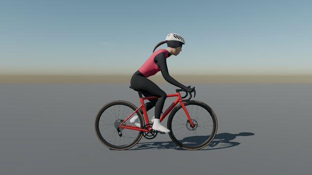 | 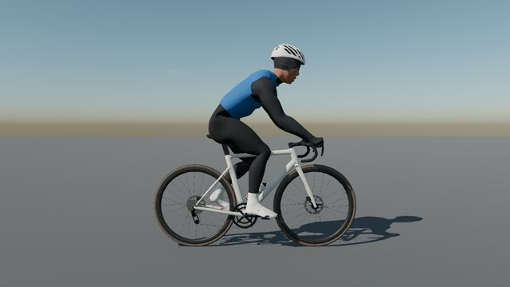 |
| Front and hands | 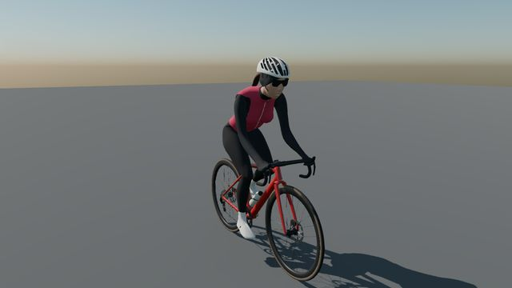 | 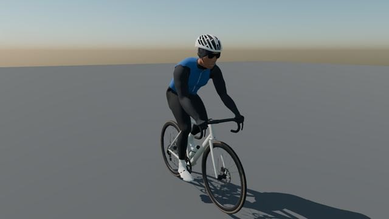 |
| Chase | 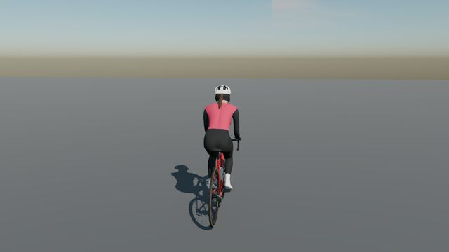 | 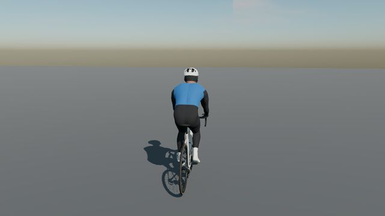 |
| Cap beneath helmet | 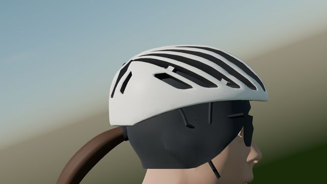 | 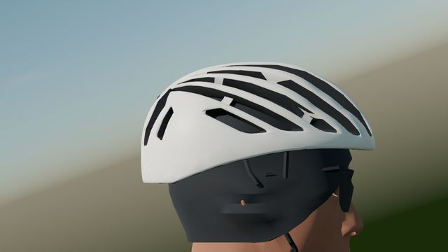 |
| Standing | 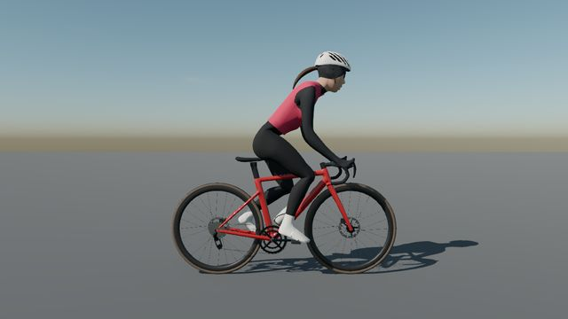 | 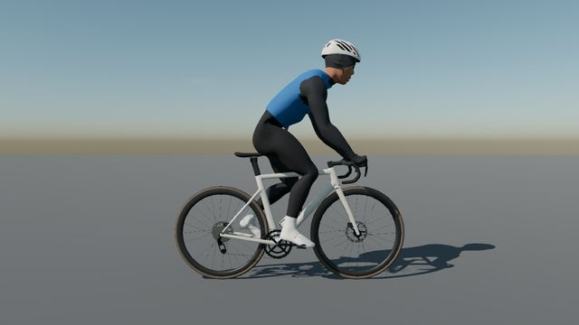 |
| Back hem, seated | 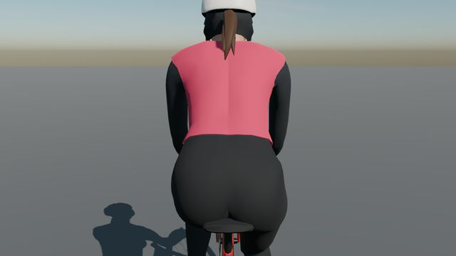 | 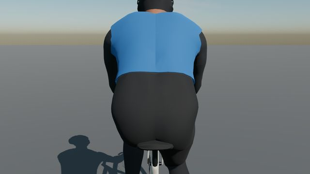 |
| Back hem, standing | 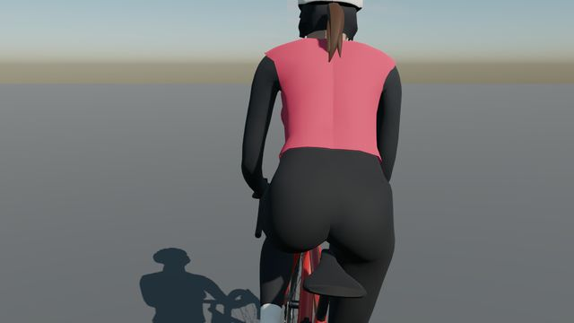 | 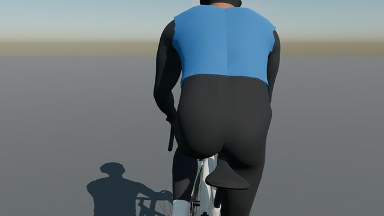 |

Compare the same [female](images/models/riders/female-side.jpg) and
[male](images/models/riders/male-side.jpg) views in short kit.

`art/riders/build.py` builds both kits by default; `KIT=winter` limits the run to the
two winter assets and validates their fit against the committed `riders.json`. The gilet
copies the torso's skin weights, is thinned separately and has a closed inner shell at its
hem and arm openings. Bike parts and node/bone contracts stay shared. Runtime material
names map onto the existing rider palette; no new dependency, texture or network call is
needed. Neither generator nor stored-world format changes.

The hem retains the original waist plane while fitting the shell to the body. Winter torso
weights exclude thigh movement above that plane and blend it into the hips over 10 cm below
the waist; the gilet and base layer therefore stay together through the pedal stroke.
The zip uses front-facing surfaces on the front of the torso, keeping pale fragments off
the back. Seated and standing back close-ups check both fits.

The final female winter body has 41,819 triangles and the male 40,455, within the existing
41–43k rider budget. Each bike remains 18,036 triangles. Only the chosen kit is instantiated.
Rebuilding both winter assets produces byte-identical GLBs (SHA-256 comparison).

The local Season option dresses the rider, ghost and group riders, including later arrivals.
Switching kit preserves crank and wheel phase, ghost transparency and first-person body
hiding. Gilets carry the ghost/group accent where present. No new usage workflow or control
is introduced, so the usage wiki does not change.

Reproduce the model review in the dev container:

```sh
SEASON=Winter GALLERY=docs/images/models \
  VIEWS="side side-down front chase face head kit-back kit-back-standing helmet-side helmet-rear standing standing-down standing-back standing-up standing-rise standing-chase" \
  scripts/render-riders.sh
```

The headless rider check exercises both kits through seated and standing pedal cycles and
coasting, and rejects any leg-bone influence on the gilet or zip. That regression catches
the former back-hem distortion. The seasons check switches Autumn/Winter/Spring/Summer and an unknown season,
checks actual garment surfaces and accent colours, first-person hiding, phase continuity,
existing group members and new arrivals. Software Vulkan images establish appearance and
rendering compatibility; native M1 frame time still needs measurement on that hardware.

Validation: Rust formatting, Clippy, workspace tests and dependency/license checks passed;
GDScript lint/format, translation checks, every Godot headless/display suite and `make
wiki-check` passed. The final winter assets also passed the rider and season regressions
after visual refinement, and all 32 winter gallery views were rendered and inspected.
