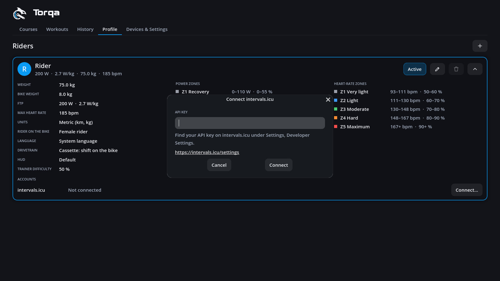
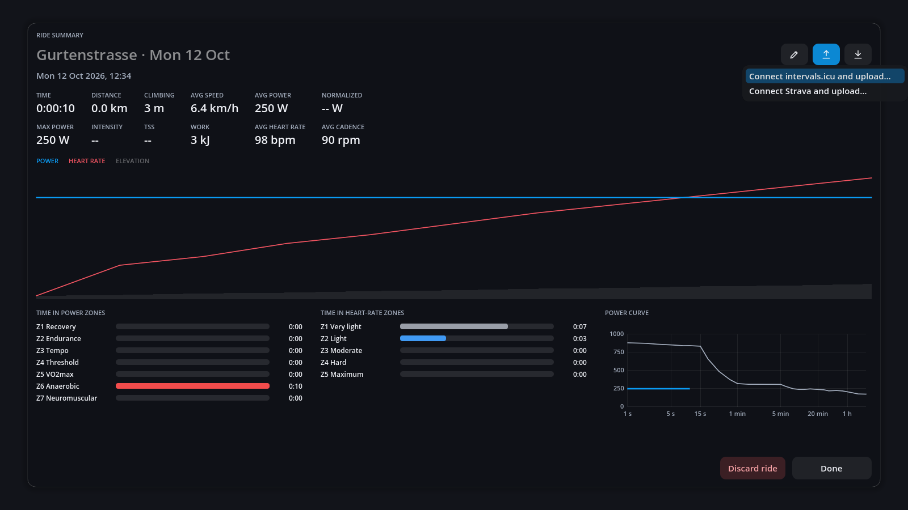

# Uploading rides

Rides go up to **intervals.icu** straight from Torqa: from a ride's summary right after
riding, later from the **History** tab, or by themselves once you keep them. Torqa sends the ride's FIT file under the ride's
name (R50). Strava is to follow; why Garmin Connect, TrainingPeaks and Komoot are not offered
is in [ADR 0013](adr/0013-activity-uploads.md).

## Connecting intervals.icu

1. On intervals.icu, open **Settings** and find **Developer Settings** near the bottom. Create
   an **API key** there if you have none, and copy it.
2. In Torqa, open the **Profile** tab and unfold your rider's card with the chevron. Under
   **Accounts**, press **Connect…** beside intervals.icu. Or start uploading a ride: Torqa asks
   you to connect first.
3. Paste the key and press **Connect**. Torqa checks it with intervals.icu; the card then says
   *Connected as* and your name there.

   

Each rider connects their own account. **Disconnect** on the card forgets it.

Accounts are at the bottom of the unfolded card, see [riders.md](riders.md).

## Uploading

- Press the up arrow beside the ride's title (**Upload**), in the summary or in the history,
  and choose **Upload to intervals.icu**. The ride goes up under the name it shows.

  

- Once it is there, the same menu says **View on intervals.icu** and opens the ride on the
  platform. Torqa remembers this with the ride.
- A ride the platform already has, e.g. one uploaded by hand, counts as uploaded and links to
  it.
- If intervals.icu no longer accepts the key (you deleted it there), Torqa asks you to connect
  again and then uploads the ride.
- Uploading needs the internet; everything else works offline as before.

## Uploading automatically

Tick **Upload automatically** beside a connected account on your rider's card, and every
ride you keep goes up there by itself: when you close its summary with **Done**. Not before,
so the name you give it on the summary is the one it gets, and never for a ride you discard.

- A ride already there, e.g. uploaded from the summary before pressing Done, is not sent again.
- While it goes up, the ride's upload menu in the history says *Uploading to …*.
- If it fails, e.g. offline, the ride simply isn't uploaded yet: upload it from the history
  later. When the platform no longer accepts the account, connect it again on your card.

## Garmin Connect, TrainingPeaks, Komoot

These platforms only let approved partners in, so Torqa cannot upload to them. Export the ride
with the arrow beside its title (**Export FIT file**, see [history.md](history.md)) and import
the file on the platform, e.g. with Garmin Connect's *Import Data*.

## Privacy

The API key is kept in the rider's folder, `profiles/<rider>/accounts.toml` in the data
directory. On macOS and Linux only your user can read it. It syncs with the data directory
like your rides. Torqa talks to intervals.icu directly, with no server in between.
