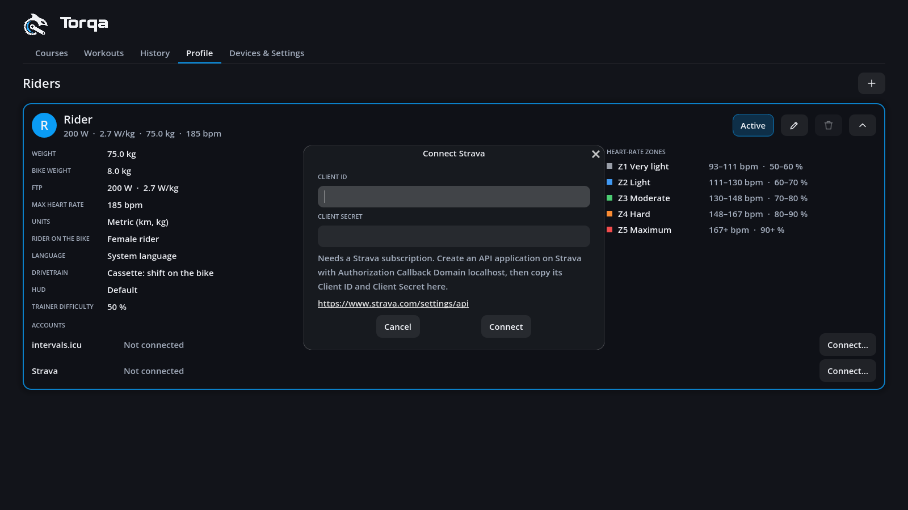

# Uploading rides

Rides go up to **intervals.icu** and **Strava** straight from Torqa: from a ride's summary
right after riding, later from the **History** tab, or by themselves once you keep them. Torqa
sends the ride's FIT file under the ride's name (R50). Why Garmin Connect, TrainingPeaks and
Komoot are not offered is in [ADR 0013](adr/0013-activity-uploads.md).

Each rider connects their own accounts, under **Accounts** at the bottom of their unfolded
card in the **Profile** tab ([riders.md](riders.md)). Or start uploading a ride: Torqa asks
you to connect first. **Disconnect** on the card forgets the account and, on Strava, withdraws
Torqa's access. Deleting a rider does the same for all their accounts.

## Connecting intervals.icu

1. On intervals.icu, open **Settings** and find **Developer Settings** near the bottom. Create
   an **API key** there if you have none, and copy it.
2. In Torqa, press **Connect…** beside intervals.icu on your card.
3. Paste the key and press **Connect**. Torqa checks it with intervals.icu; the card then says
   *Connected as* and your name there.

   

## Connecting Strava

Strava lets an app in only with the app's secret, and an open-source app cannot keep one
secret ([ADR 0013](adr/0013-activity-uploads.md)). So Torqa connects through a Strava API
application of your own. Setting it up takes a few minutes, once:

1. Log in on Strava's [API settings page](https://www.strava.com/settings/api) and create an
   application. Strava asks for a subscription for this. Name, category and website are up to
   you; set **Authorization Callback Domain** to `localhost`.
2. In Torqa, press **Connect…** beside Strava on your card.
3. Copy the application's **Client ID** and **Client Secret** into the dialog and press
   **Connect**.

   

4. Your browser opens Strava's login. Allow Torqa to upload your activities (leave that box
   ticked). The page then says that Torqa is connected and can be closed; the card says
   *Connected as* and your name on Strava. Should the browser not have opened, **Open the
   login again** in the dialog does it; **Cancel** gives up waiting.

An application of your own serves you alone (Strava allows its owner as its only athlete),
which is all Torqa needs. Each rider uploading to Strava creates their own.

## Uploading

- Press the up arrow beside the ride's title (**Upload**), in the summary or in the history,
  and choose the platform, e.g. **Upload to Strava**. The ride goes up under the name it shows,
  on Strava as a ride on a trainer.

  

- Once it is there, the same menu says **View on …** and opens the ride on the platform.
  Torqa remembers this with the ride. Strava takes a few seconds to process a ride first.
- A ride the platform already has, e.g. one uploaded by hand, counts as uploaded and links to
  it.
- If a platform no longer accepts the account (you deleted the key on intervals.icu, revoked
  Torqa's access on Strava or changed your application's secret), Torqa says why, asks you to
  connect again and then uploads the ride.
- **Strava without a subscription**: Strava switches off the API application of an account
  without a Strava subscription. Logging in still works, but uploads are refused, and Torqa
  says so. Subscribe, reactivate the application on Strava's
  [API settings page](https://www.strava.com/settings/api), then upload again.
- Uploading needs the internet; everything else works offline as before.

## Uploading automatically

Tick **Upload automatically** beside a connected account on your rider's card, and every
ride you keep goes up there by itself: when you close its summary with **Done**. Not before,
so the name you give it on the summary is the one it gets, and never for a ride you discard.

- A ride already there, e.g. uploaded from the summary before pressing Done, is not sent again.
- While it goes up, the ride's upload menu in the history says *Uploading to …*.
- If it fails, e.g. offline, the ride simply isn't uploaded yet: upload it from the history
  later. When the platform no longer accepts the account, connect it again on your card.

## Garmin Connect, TrainingPeaks, Komoot

These platforms only let approved partners in, so Torqa cannot upload to them. Export the ride
with the arrow beside its title (**Export FIT file**, see [history.md](history.md)) and import
the file on the platform, e.g. with Garmin Connect's *Import Data*.

## Privacy

The intervals.icu key, the Strava application's ID and secret and Strava's tokens are kept in
the rider's folder, `profiles/<rider>/accounts.toml` in the data directory. On macOS and Linux
only your user can read it. It syncs with the data directory like your rides. Torqa talks to
the platforms directly, with no server in between; for the Strava login it listens on your
computer only (`127.0.0.1`), and only until you are back.
